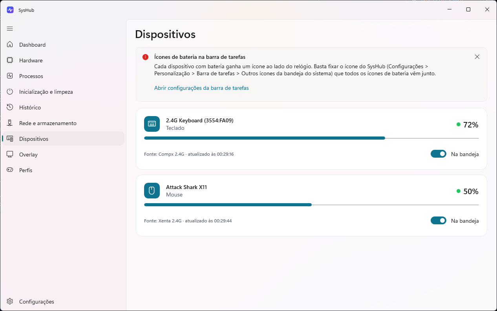

 

**Temperaturas, FPS nos jogos, bateria do fone e do mouse, processos, inicialização e histórico.** 
Tudo num app nativo, leve e bonito para Windows.

 

 

  

[Recursos](#-recursos) · [Overlay](#-overlay-nos-jogos) · [Temas](#-temas) · [Instalação](#-instalação) · [Dúvidas](#-dúvidas)

 

  
   
  Bateria de teclado e mouse 2.4 GHz genéricos, lida direto do dongle. Cada um ganha seu ícone na bandeja.

 

## ✨ Recursos

<table>
  <tr>
    <td width="50%" valign="top">
      <h3>🌡️ Hardware em tempo real</h3>
      Temperatura, uso, clock e potência de CPU, GPU, placa-mãe e memória, com vários monitores e várias GPUs. Quando um sensor não responde, aparece <b>“—”</b>, nunca um número inventado.
    </td>
    <td width="50%" valign="top">
      <h3>🎮 Overlay nos jogos</h3>
      FPS, 1% low, frametime, temperaturas, VRAM e ping no canto da tela, em <b>6 estilos</b> e 8 cores. A janela é transparente: não rouba o clique nem o foco do jogo.
    </td>
  </tr>
  <tr>
    <td valign="top">
      <h3>🔋 Bateria na bandeja</h3>
      Um ícone por dispositivo (fones, mouses, teclados e controles Bluetooth, Xbox, Logitech e dongles 2.4 GHz genéricos), que fica <b>amarelo</b> abaixo de 25% e <b>vermelho</b> abaixo de 10%. Fixe o do SysHub e os outros vêm junto.
    </td>
    <td valign="top">
      <h3>📈 Histórico e alertas</h3>
      Gráficos de 5 minutos a 7 dias, com zoom e tooltip. Regras como <i>“CPU acima de 90 °C por 10 s”</i> avisam com notificação, sem repetir o aviso por 5 minutos.
    </td>
  </tr>
  <tr>
    <td valign="top">
      <h3>🧠 Gerenciador de tarefas</h3>
      Busca, agrupamento por app, uso de CPU, RAM, GPU e disco por processo. Os processos do sistema ficam protegidos, e os críticos pedem confirmação dupla.
    </td>
    <td valign="top">
      <h3>🚀 Perfis por jogo</h3>
      Quando o jogo abre, o overlay liga, o plano de energia vai para “Alto desempenho”, os LEDs trocam de efeito e os programas que você escolher (Discord, navegador…) são fechados. Quando o jogo fecha, tudo volta ao que era.
    </td>
  </tr>
  <tr>
    <td valign="top">
      <h3>🌐 Rede e armazenamento</h3>
      Velocidade por adaptador, ping e perda de pacotes, saúde e temperatura de SSD e NVMe e espaço livre por partição.
    </td>
    <td valign="top">
      <h3>🧹 Inicialização e limpeza</h3>
      Desligue o que deixa o boot lento (registro, pasta Inicializar e tarefas agendadas) e limpe temporários, cache de miniaturas e Lixeira com segurança.
    </td>
  </tr>
  <tr>
    <td valign="top">
      <h3>⌨️ Atalhos globais</h3>
      <kbd>Ctrl</kbd> + <kbd>Shift</kbd> + <kbd>O</kbd> mostra o overlay. Grave seus próprios atalhos, com aviso quando outro app já usa a combinação.
    </td>
    <td valign="top">
      <h3>🪶 Leve de verdade</h3>
      Os sensores só são lidos quando alguma tela precisa deles. Minimizado na bandeja, o uso de CPU fica perto de 0%, e ele pode iniciar com o Windows sem pedir confirmação a cada logon.
    </td>
  </tr>
  <tr>
    <td valign="top">
      <h3>🌈 Iluminação RGB</h3>
      LEDs da placa-mãe <b>ASUS AURA</b> (placa, headers RGB e ARGB) e periféricos com <b>Iluminação Dinâmica</b> do Windows 11, todos sincronizados. São 15 efeitos, incluindo os que entendem os seus fans (a luz <b>pula de fan em fan</b> ou <b>gira dentro de cada um</b>), fogo, aurora e um que segue a <b>temperatura da CPU</b>. Nada é gravado na placa: reiniciar volta ao efeito original.
    </td>
    <td valign="top">
      <h3>🔥 Teste de estresse</h3>
      Todos os núcleos a 100% por 1, 5 ou 15 min, com temperatura e clock ao vivo. Detecta <i>throttling</i>, para sozinho no limite de temperatura e guarda os resultados para comparar depois de trocar a pasta térmica.
    </td>
  </tr>
  <tr>
    <td valign="top">
      <h3>🏁 Sessões de jogo</h3>
      Cada partida vira um relatório automático: tempo jogado, FPS médio, 1% low e temperaturas máximas de CPU e GPU.
    </td>
    <td valign="top">
      <h3>⏱️ Tempo de inicialização</h3>
      Quanto o Windows leva até a área de trabalho e até ficar pronto, se está piorando e quais programas mais atrasam o boot.
    </td>
  </tr>
  <tr>
    <td valign="top">
      <h3>🌡️ Temperatura na bandeja</h3>
      A temperatura da CPU e da GPU ao lado do relógio, em amarelo a partir de 75 °C e vermelho a partir de 88 °C.
    </td>
    <td valign="top">
      <h3>🚨 LEDs nos alertas</h3>
      Quando um alerta dispara (ex.: CPU acima de 90 °C), o gabinete pisca em vermelho por 10 segundos.
    </td>
  </tr>
<tr>    <td valign="top">      <h3>🕹️ Estilos de interface</h3>      Não muda só a cor: <b>Retrô</b> (terminal de fósforo verde, fonte monoespaçada, cantos retos), <b>Gamer</b> (fonte condensada, cantos vivos, vermelho no grafite) e <b>Synthwave</b> (neon rosa e roxo). Além de 8 paletas para o visual padrão.    </td>    <td valign="top">      <h3>💽 Velocidade do disco</h3>      Gravação e leitura sequenciais e leitura aleatória 4 KB (IOPS), medidas sem o cache do Windows, com avaliação do resultado: HD, SSD SATA ou NVMe.    </td>  </tr>
  <tr>
    <td colspan="2" valign="top">
      <h3>📱 SysHub no celular novo</h3>
      Temperaturas, FPS, uso de CPU e GPU e bateria dos dispositivos <b>ao vivo no navegador do celular</b>, como uma segunda tela enquanto você joga em tela cheia. É só ler o QR code; não precisa instalar nada. Desligado por padrão, só leitura e só na sua rede local.
    </td>
  </tr>
</table>

## 🎮 Overlay nos jogos

  

<b>Os 6 estilos</b>

 

| Estilo | Como é |
|---|---|
| **Clássico** | Fundo escuro translúcido, rótulos discretos e valores em destaque |
| **Compacto** | Fonte monoespaçada, rótulos em caixa alta na cor de destaque e menos espaço ocupado |
| **Minimalista** | Sem fundo nenhum: texto com contorno, legível em qualquer cena |
| **Neon** | Borda com brilho e rótulos na cor de destaque |
| **Pílulas** | Cada métrica no seu próprio fundo arredondado |
| **Barras** | Barra de 0 a 100% sob cada valor (só para métricas com escala real, como uso e temperatura) |

Valores acima do limite que você define (ex.: CPU acima de 90 °C) ficam em vermelho. O FPS é medido em jogos DirectX 9 a 12.

## 🎨 Temas

  

Claro, escuro ou seguindo o Windows, com **8 paletas**, trocadas na hora. Para mudar mais que a cor, há três **estilos completos**: Retrô, Gamer e Synthwave, que trocam também as fontes e o formato dos cantos. Um teste automático garante contraste de leitura (WCAG AA) em todas as combinações.

## ⬇️ Instalação

1. **Baixe** o [`SysHubApp-win-Setup.exe`](https://github.com/BryanMoreira0717/SysHub-releases/releases/latest/download/SysHubApp-win-Setup.exe) (cerca de 85 MB).
2. **Execute.** O SysHub é instalado só para o seu usuário e não precisa de .NET nem de mais nada.
3. **Confirme o UAC** quando ele abrir. O app precisa de administrador para ler os sensores, gerenciar processos e a inicialização.

> [!NOTE]
> O instalador ainda não tem assinatura digital. Se aparecer **“O Windows protegeu o computador”**, clique em **Mais informações → Executar assim mesmo**.

| | |
|---|---|
| **Requisitos** | Windows 10 22H2 ou Windows 11, 64 bits |
| **Atualizar** | O app avisa quando sai uma versão nova. Para instalar: **Configurações → Atualizações → Instalar e reiniciar** |
| **Desinstalar** | **Configurações do Windows → Aplicativos → SysHub**. A tarefa “Iniciar com o Windows” sai junto, e suas configurações e seu histórico ficam guardados |

## 🔒 Privacidade

- **Sem telemetria, sem conta, sem anúncio.** Nenhuma leitura, processo ou dispositivo sai do seu computador.
- **Rede só quando você pede:** o ping roda só com a tela de rede ou o overlay de ping abertos, e o IP público fica desligado por padrão.
- **Atualizações:** o app só consulta as releases públicas e não baixa nada sem você pedir.

Detalhes em [`PRIVACY.md`](PRIVACY.md).

## ❓ Dúvidas

<b>Por que o SysHub pede permissão de administrador?</b>

 
Temperaturas e sensores da placa-mãe, encerrar processos e mexer nos programas da inicialização exigem administrador no Windows. Quando ele inicia com o Windows, a tarefa agendada já abre o app elevado, sem pedir confirmação a cada logon.

<b>O FPS aparece como “—” no meu jogo</b>

 
O FPS é medido em jogos DirectX 9 a 12. Em Vulkan e OpenGL ele pode não aparecer. Use o jogo em janela ou em tela cheia sem bordas para o overlay ficar por cima.

<b>Meu fone não mostra bateria</b>

 
O SysHub lê a bateria pelos padrões Bluetooth (BLE e clássico), controles Xbox, Logitech HID++ e protocolos de vários dongles 2.4 GHz genéricos. Alguns fones usam protocolos fechados, sem documentação, e ainda não aparecem.

<b>Abri o SysHub de novo e nada aconteceu</b>

 
Ele já estava aberto, na bandeja. Abrir de novo só traz a janela para a frente, sem pedir o UAC outra vez.

<b>Onde ficam meus dados?</b>

 

| | |
|---|---|
| Configurações | `%AppData%\SysHub\settings.json` |
| Histórico, perfis e alertas | `%LocalAppData%\SysHub\syshub.db` |
| Logs | `%LocalAppData%\SysHub\logs` (rotativo, 7 × 10 MB) |
| App instalado | `%LocalAppData%\SysHubApp` |

 

  
   
  Feito para Windows · WinUI 3 nativo · sem telemetria · <a href="THIRD_PARTY_NOTICES.md">componentes de terceiros</a>

